Desarrollo aplicaciones con inteligencia artificial para equipos que necesitan saber qué está pasando:
herramientas que **recogen información de la web y de documentos, la ordenan en bases de datos y avisan cuando algo
cambia**. Trabajo desde Colombia, en remoto o en sitio, para proyectos de cualquier ciudad.

### Qué hago

| Etapa | Qué entrego |
| --- | --- |
| **Recopilar** | **Web scraping:** datos de portales, PDF y documentos escaneados (OCR), limpios y listos para usar. **OSINT:** investigación con fuentes abiertas, verificación y cruce de registros públicos, cada dato con su fuente. |
| **Ordenar y automatizar** | **Apps con IA:** asistentes y agentes conectados a los datos y a los procesos de cada equipo. **Automatización:** reportes, alertas, carga de datos y documentos que se hacen solos. |
| **Monitorear y medir** | **Seguimiento y monitoreo:** tableros e indicadores que siguen un tema, una marca o un proceso y avisan a tiempo. **Marketing con datos:** escucha de redes, segmentación de audiencias y contenido medido con cifras reales. |

### Cómo trabajo

- **Solo información pública o autorizada.** Scraping y OSINT dentro de la ley, respetando los términos de cada sitio
  y la protección de datos personales (Ley 1581 de 2012).
- **Cada dato con su fuente.** Los informes y tableros dicen de dónde salió cada cifra.
- **La IA acelera; las pruebas deciden.** Nada se entrega sin pruebas automáticas y revisión.
- **Pensado para el celular.** Interfaces livianas que cargan rápido en cualquier teléfono.

### Proyectos

| Proyecto | Qué es |
| --- | --- |
| **Voz de Barrio** | Plataforma cívica para un municipio del Caribe colombiano: mapa interactivo de 56 barrios, participación verificada por cédula, noticias y panel privado de administración. *Repositorio privado.* |
| **INNOBUS** | Plataforma de movilidad y transporte. *Repositorio privado.* |

### Herramientas

**IA y automatización**

**Recolección de datos**

**Datos**

**Web**

**Infraestructura**

