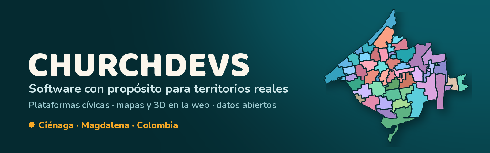

### Construyo software que se usa en la calle, no solo en la oficina.

Desarrollador **full stack** desde Ciénaga (Magdalena, Colombia). Hago plataformas cívicas y de datos
territoriales que funcionan en el celular más sencillo y que, en un equipo potente, se ven de película:
mapas reales, 3D en la web y datos ordenados para decidir mejor.

**Cómo trabajo**

- **Celular primero.** Si no carga rápido en un Android de gama baja con datos prepago, no está terminado.
- **Dos capas.** Una base liviana que funciona sola y una capa premium (WebGL, animación) que solo se descarga
  donde el equipo puede con ella.
- **Datos con fuente.** Nada inventado: cada cifra lleva de dónde salió.
- **Privacidad por diseño.** Los datos personales no salen de donde deben estar (Ley 1581 de 2012).
- **Pruebas antes de publicar.** Pruebas automáticas, laboratorio de interfaz y revisión de rendimiento en cada entrega.

**Proyectos**

| Proyecto | Qué es |
| --- | --- |
| **Voz de Barrio** | Plataforma cívica de Ciénaga: cada barrio dice lo que le hace falta y se ve en un mapa público de 56 barrios, con página propia por barrio, noticias y voceros. Base liviana + maqueta 3D con three.js. *(repositorio privado)* |
| **INNOBUS** | Plataforma de movilidad y transporte. *(repositorio privado)* |

**Herramientas**

La portada dibuja los 56 barrios reales de Ciénaga, cada uno con su color.
